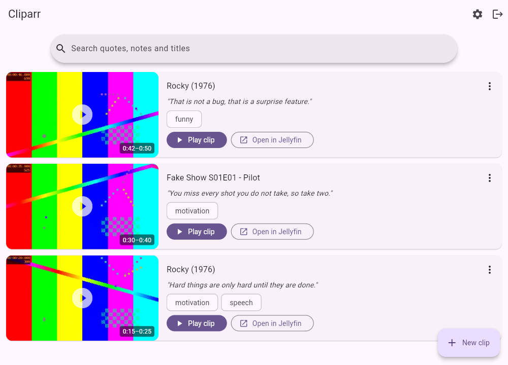
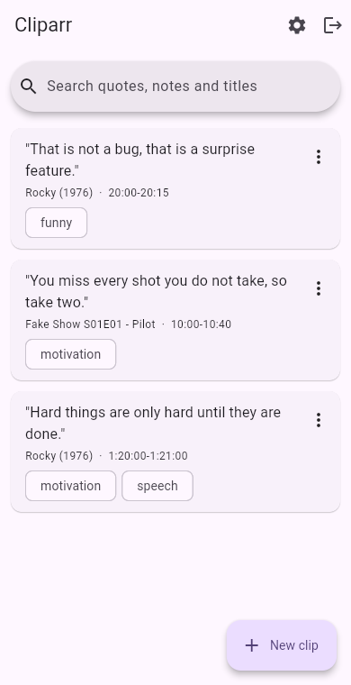

<p align="center">
  
</p>

# Cliparr

[](https://github.com/bergercookie/cliparr/actions/workflows/ci.yml)
[](https://github.com/bergercookie/cliparr/actions/workflows/code-quality.yml)
[](https://codecov.io/gh/bergercookie/cliparr)
[](https://github.com/bergercookie/cliparr/releases/latest)

Bookmark the moments of your Jellyfin movies and shows that you want to see again: a motivating speech, a perfect one-liner, a scene that just works. Every bookmark is a card with a picture from the scene, your own notes and tags. Play it here on a loop, or jump to the same moment in Jellyfin.

- Log in with your existing Jellyfin account. Nothing new to set up for your users.
- Pick any movie or episode, mark the start and end while watching, add a quote and a note.
- Each bookmark shows a preview picture of the scene.
- Open a bookmark in Cliparr, or at the exact time in Jellyfin on your TV, phone or computer.
- A browser extension adds a Bookmark button to Jellyfin's own player.
- Search and filter all your bookmarks from one page.
- Self-hosted: one small container, one SQLite file.
- Works with single sign-on (Authelia and similar) behind a reverse proxy.
- Web interface (served by the container), Android app, Linux desktop app.

<p align="center">
  
  
</p>

Cliparr only stores *where* a clip is (item, start, end) plus your text, and small preview pictures. The video itself always streams from your Jellyfin server.

## Quick start

You need a running Jellyfin server and Docker with Compose. Save this as `compose.yaml`, set your Jellyfin address, and start it:

```yaml
services:
  cliparr:
    image: ghcr.io/bergercookie/cliparr:latest
    restart: unless-stopped
    ports:
      - "8080:8080"
    environment:
      CLIPARR_JELLYFIN_URL: http://192.168.1.10:8096 # how this container reaches Jellyfin
    volumes:
      - cliparr-data:/data

volumes:
  cliparr-data:
```

```sh
docker compose up -d
```

A commented version with the optional settings is in [`compose.example.yaml`](compose.example.yaml).

Open <http://localhost:8080> and log in with your Jellyfin username and password.

## Documentation

| I want to...                                   | Read                                              |
| ---------------------------------------------- | ------------------------------------------------- |
| Install and use Cliparr                        | [Getting started](docs/getting-started.md)        |
| Look up a setting                              | [Configuration](docs/configuration.md)            |
| Serve it over HTTPS with Caddy                 | [Reverse proxy and HTTPS](docs/reverse-proxy.md)  |
| Use Authelia or another SSO provider           | [Single sign-on](docs/sso.md)                     |
| Install the Android or Linux app               | [Apps](docs/apps.md)                              |
| Bookmark from Jellyfin's web player            | [Browser extension](docs/extension.md)            |
| Fix a problem                                  | [Troubleshooting](docs/troubleshooting.md)        |
| Understand how it works                        | [How it works](docs/how-it-works.md)              |
| Hack on Cliparr                                | [Development](docs/development.md)                |
| Cut a release                                  | [Releasing](docs/releasing.md)                    |

The same pages are published at <https://bergercookie.github.io/cliparr/>.

## Status

Cliparr is young. Every change is tested in CI against real Jellyfin servers (10.11 and the newest release): logging in, searching, playing, preview pictures, both "Open in Jellyfin" buttons and the browser extension in Chrome. Not covered yet: the Firefox extension (it is only linted), Jellyfin's TV and phone apps as targets of "Play on a device" (only its web client is tested), and browsers that play H.264 themselves (the test browser makes Jellyfin convert the video). Real-world reports are welcome.
