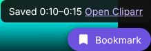

# Browser extension (Chrome and Firefox)

The extension adds a **Bookmark** button to Jellyfin's video player in your browser. Click it where a moment starts, click again where it ends, and the bookmark appears in Cliparr, with a preview picture, ready to replay.

You do not log in to Cliparr separately. The extension uses the Jellyfin login that your browser already has, and Cliparr checks it with Jellyfin.

## Install

Download the two zip files from the latest [GitHub release](https://github.com/bergercookie/cliparr/releases): `cliparr-extension-<version>-chrome.zip` and `cliparr-extension-<version>-firefox.zip`. They are not in the browser stores yet, so you add them by hand.

**Chrome, Edge, Brave and other Chromium browsers**

1. Unzip the `-chrome.zip` file into a folder you will keep.
2. Open `chrome://extensions` (or `edge://extensions`) and switch on **Developer mode**.
3. Click **Load unpacked** and choose the folder.

**Firefox (140 or newer)**

Firefox only keeps add-ons that Mozilla has signed, and these are not signed yet. Until they are, you can load the `-firefox.zip` file for the current session:

1. Open `about:debugging#/runtime/this-firefox`.
2. Click **Load Temporary Add-on** and choose the zip file.

The add-on is removed when Firefox closes. Firefox Developer Edition and Nightly can keep unsigned add-ons permanently if you set `xpinstall.signatures.required` to `false` in `about:config`.

## Set it up

1. Click the Cliparr icon in the toolbar (or open the extension's options).
2. Enter the **Jellyfin address** exactly as you open Jellyfin in this browser, for example `http://192.168.1.10:8096`.
3. Enter the **Cliparr address**, for example `http://192.168.1.10:8080`. You can copy it from Cliparr's web interface: Settings, Other devices.
4. Click **Save**. The browser asks for permission to use those two addresses. Allow it.
5. Click **Test connection** to check that Cliparr answers.

The extension only gets access to those two addresses, never to other sites.

If Cliparr is behind single sign-on, use the separate host name for apps described in [Single sign-on](sso.md#the-apps-and-the-browser-extension-cannot-do-sso). The extension cannot complete an Authelia login.

## If the extension cannot reach Cliparr

When you save, and with **Test connection**, the extension asks Cliparr who it is. If that fails, the page says `Cannot reach Cliparr at …`. Browsers do not say why: a wrong address, a stopped Cliparr and a certificate the browser does not trust all look the same. Firefox words every one of them as `CORS request did not succeed` with status `(null)` in its console. Cliparr is not missing any CORS header, so that message is no reason to change the server.

- Check the address and port, and that Cliparr is running: open the address in a normal tab.
- With an `https` address and a certificate from your own authority or a self-signed one (for example Caddy's `tls internal`), the tab shows a certificate warning. An extension cannot show that warning itself, so accept it once in a tab (in Firefox: Advanced, Accept the Risk and Continue), then press **Test connection** again. To avoid the warning for good, add your certificate authority to the browser; for Caddy see [Getting a certificate](reverse-proxy.md#getting-a-certificate).
- **Press Save first** is shown when the browser has not yet allowed the extension to use that address.

## Use it

1. Open a movie or episode in Jellyfin and play it. The **Bookmark** button appears at the bottom right, and fades out with Jellyfin's own controls.
2. Click it (or press <kbd>B</kbd>) at the start of the moment. The button turns red and says where you started.
3. Play on to the end of the moment and click again. The bookmark is saved, and a message offers a link to open Cliparr.

Shortcuts:

| Keys | What happens |
| --- | --- |
| <kbd>B</kbd> or click | Mark the start, then mark the end and save |
| <kbd>Shift</kbd>+<kbd>B</kbd> or <kbd>Shift</kbd>+click | Save the last 10 seconds right away |
| <kbd>Esc</kbd> | Cancel a start mark |

You can add a quote, note and tags afterwards in Cliparr.

### How exact is the time?

The extension reads the time from the video itself, which is exact. When Jellyfin converts the video while playing (transcoding) and started part-way in, the video's own clock restarts at zero. In that case the extension uses the position Jellyfin last reported, which can be a few seconds behind. It then says "position approximate". Pause the video first to get an exact position: Jellyfin reports immediately when you pause.

## Privacy and security

- The extension sends your Jellyfin login token to the Cliparr address you entered, and nowhere else. It has no analytics.
- Cliparr asks your Jellyfin server whether the token is valid and whose it is, then acts as that user: Jellyfin still decides what you may see. Administrator API keys are not accepted this way.
- If your Cliparr address starts with `http://` the token travels unencrypted. That is fine inside your home network. For anything else, serve Cliparr over HTTPS (see [Reverse proxy and HTTPS](reverse-proxy.md)).
- Anyone who obtains a Jellyfin token could use it with Cliparr, just as they could use it with Jellyfin. Log out of Jellyfin on devices you no longer trust.

## Troubleshooting

| What you see | What to do |
| --- | --- |
| No Bookmark button | Reload the Jellyfin tab and start a video. The Jellyfin address in the options must match the address bar exactly, including the port. |
| "Jellyfin has not reported this video yet" | Let the video play for a few seconds, then try again. |
| "Cannot find your Jellyfin login on this page" | Log in to Jellyfin again in this tab. |
| "Cliparr cannot be reached" | Check the Cliparr address with **Test connection** in the options. |
| "Jellyfin did not accept your login" | Log in to Jellyfin again. Tokens end when you sign out. |
| "Set your Cliparr address" | Open the options and save both addresses. |

## Status

The extension is checked automatically in Chromium against a stand-in for Jellyfin's web player, and the Firefox build is checked with Mozilla's `web-ext` linter. It reads Jellyfin's own login storage and player state, so a future Jellyfin release could change what it sees; if the button misbehaves after a Jellyfin upgrade, please report it with the versions of Jellyfin and your browser.
