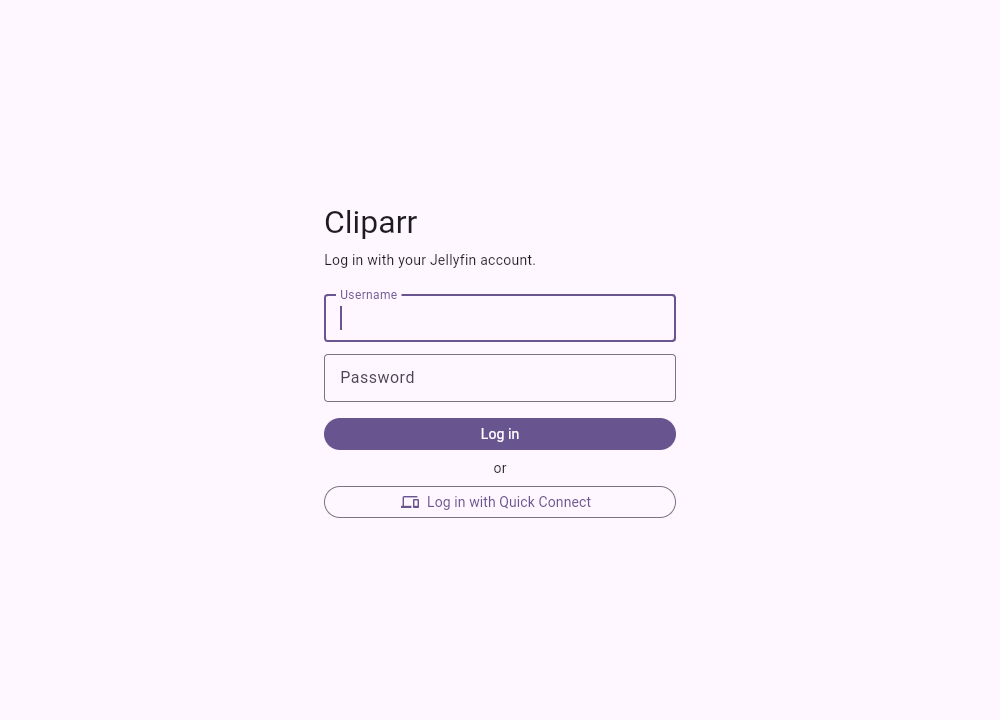
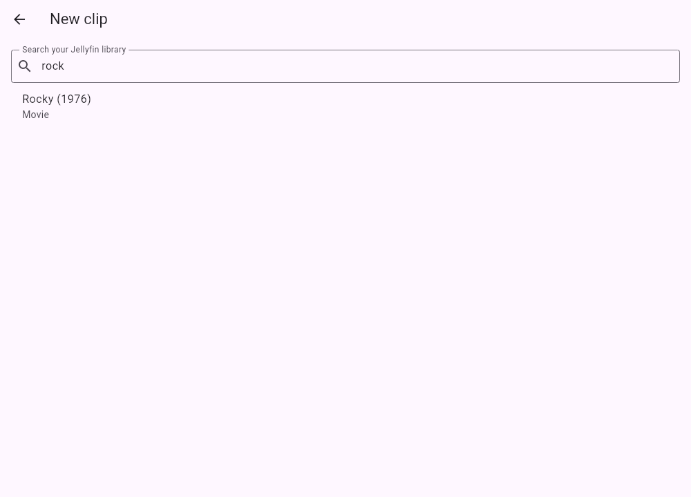
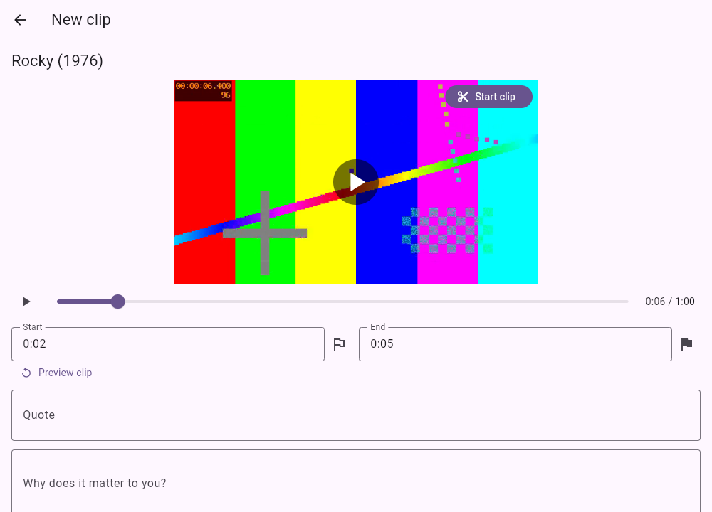
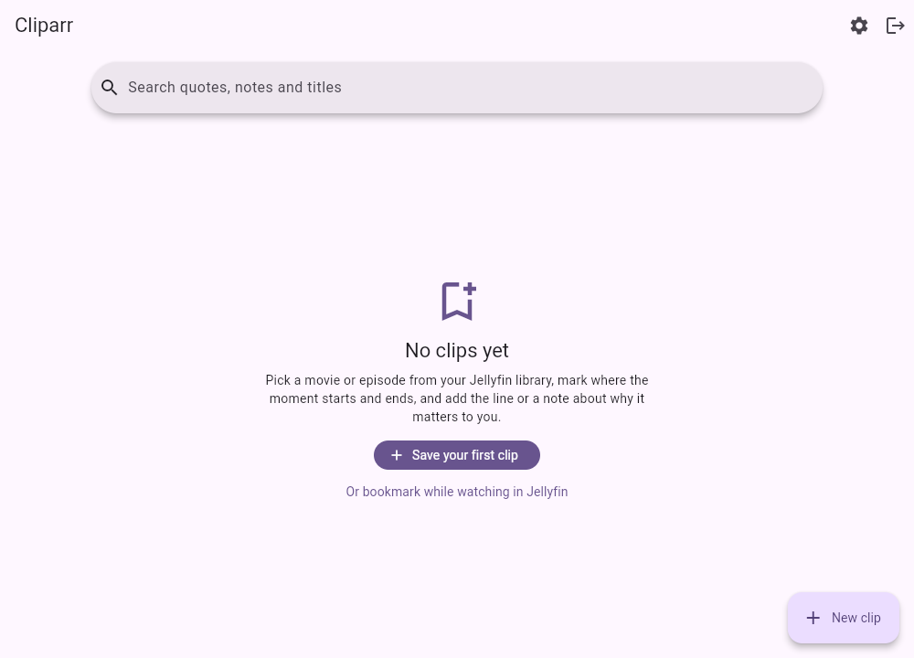
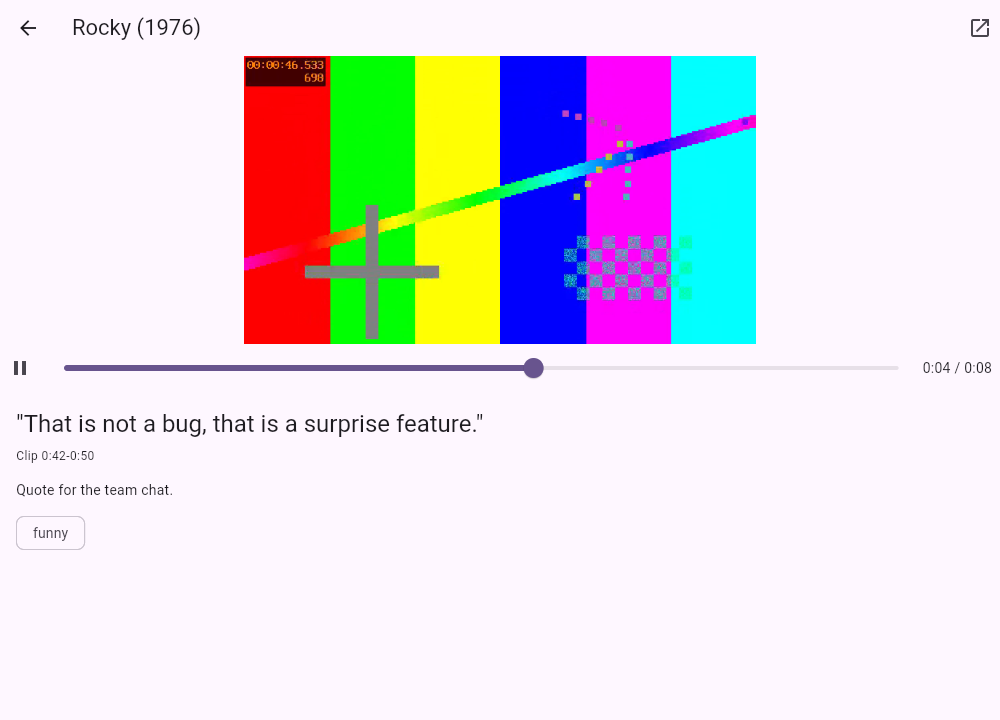
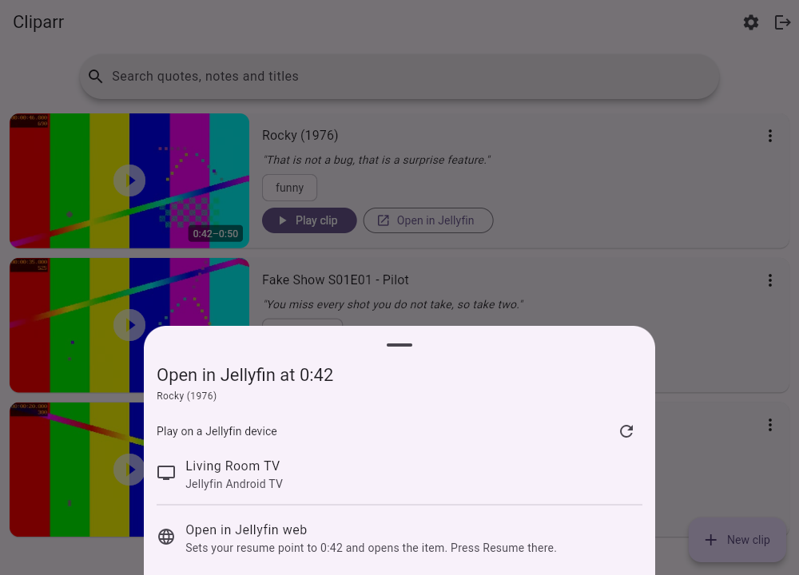
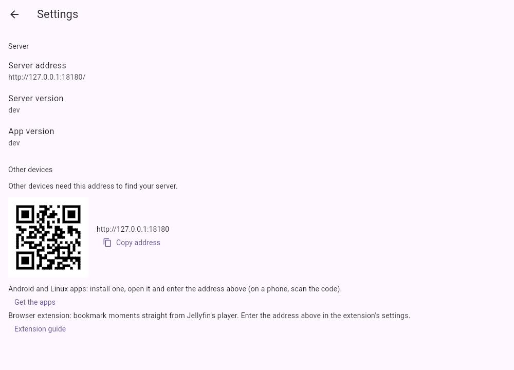

# Getting started

## What you need

- A running Jellyfin server that the Cliparr container can reach over the network. Every change to Cliparr is tested against Jellyfin 10.11 and the newest release (12.x). Jellyfin 10.9 and 10.10 use the same interfaces and should work, but cannot be tested any more because Jellyfin no longer offers them for download.
- Docker with Compose.
- A Jellyfin account. Cliparr uses it to log you in; no extra accounts are created.

## Install

Download the commented example, [`compose.example.yaml`](https://github.com/bergercookie/cliparr/blob/master/compose.example.yaml), and save it as `compose.yaml` on your server:

```sh
curl -fsSL -o compose.yaml https://raw.githubusercontent.com/bergercookie/cliparr/master/compose.example.yaml
```

Edit two things in it. First, set `PUID` and `PGID` to your own user and group, the output of `id -u` and `id -g`: everything Cliparr stores then belongs to you, which makes backups easy. Second, set `CLIPARR_JELLYFIN_URL` to the address of Jellyfin **as seen from the container**:

- Jellyfin in another Compose project on the same Docker network: use its service name, e.g. `http://jellyfin:8096`.
- Jellyfin in another Compose project or on another machine: use the host's LAN address, e.g. `http://192.168.1.10:8096`. `localhost` will not work, because inside the container that means the container itself.

Start it with `docker compose up -d`, then open <http://localhost:8080>.

The folder `cliparr-data`, next to `compose.yaml`, holds everything Cliparr stores: the database `cliparr.db` with all clips and login sessions, and the preview pictures. It belongs to you, so you can copy it like any other folder; stop Cliparr first (`docker compose stop`) so that the copy is consistent. See [Data folder and permissions](configuration.md#data-folder-and-permissions) for how this works.

For HTTPS and a proper domain name, continue with [Reverse proxy and HTTPS](reverse-proxy.md).

## Check that it works

```sh
docker compose logs cliparr
```

A healthy start ends with two lines like these:

```
level=INFO msg="cliparr started" version=0.1.0 listen=:8080 jellyfin=http://192.168.1.10:8096 proxyAuth=false
level=INFO msg="jellyfin reachable" url=http://192.168.1.10:8096 version=12.2.0 name=Home
```

The second line means Cliparr can talk to Jellyfin; it shows Jellyfin's version. If you see `cannot reach Jellyfin yet` instead, fix `CLIPARR_JELLYFIN_URL`: nobody can log in until it is right. Cliparr keeps trying, so it recovers by itself once Jellyfin answers, which is useful when both start together in one Compose file. A warning about `CLIPARR_JELLYFIN_PUBLIC_URL` means the links that open Jellyfin will not work from other devices; see [Configuration](configuration.md#basic-settings).

## Save your first clip

1. Log in with your Jellyfin username and password. Nothing needs to be created first: Cliparr uses the accounts Jellyfin already has.

   

2. Click **Save your first clip** (later: **New clip**) and search for a movie or episode. Click a result.

   
3. The video starts playing by itself. Click **Start clip** on the video at the moment you like, let it play on, and click **End clip** where the scene ends. The two times appear in the **Start** and **End** fields below the video, where you can also type them (such as `1:23` or `1:02:03`). Click the video or press the space bar to pause, and use the left and right arrow keys to jump five seconds.

   
4. Click **Preview clip** to loop the range. Adjust the times until it feels right.
5. Add the quote, a note about why it matters to you, and some comma-separated tags. Click **Save clip**.



## Your bookmarks

The clips page shows every bookmark as a card: a picture from the middle of the scene, the title, your quote and tags. Use the search box for words in the quote, note or title.


Each card has two buttons:

- **Play clip** plays the scene here, on a loop between your start and end.

  

- **Open in Jellyfin** continues in Jellyfin itself, at the moment you bookmarked. See below.

The interface follows your device's light or dark setting and also works on phones.

### Open in Jellyfin at the exact moment

Jellyfin's web addresses cannot contain a start time, so Cliparr offers two ways to land on the right second:



- **Play on a Jellyfin device.** Cliparr lists the Jellyfin apps that are running for you right now (your TV, phone, a browser tab) and tells the one you pick to play the movie from the bookmark's start. This needs Jellyfin to be open on that device.
- **Open in Jellyfin web.** Cliparr sets your *resume point* for that movie to the bookmark's start and opens it in Jellyfin; press **Resume** there. Because this replaces your real resume position, Cliparr asks first and tells you what it will replace.

For the web option to open the right address, set `CLIPARR_JELLYFIN_PUBLIC_URL` to the address you use in your browser (see [Configuration](configuration.md)).

## Use it on your phone and in Jellyfin

Open **Settings** (the gear icon) in the web interface and scroll to **Other devices**. It shows your server's address with a copy button and a QR code, and links to the apps and the browser extension. On a phone, scan the code with the camera, install the Android app from the link, and paste or type the address when the app asks for it.



## Good to know

- **Each user sees only their own clips.** A clip is tied to the Jellyfin user who made it.
- **Cliparr plays the original file** through your Jellyfin server, without transcoding. Browsers only play some formats (H.264 video with AAC audio in an MP4 is safe). If a video does not play in the web interface, try the Android or Linux app, which handle more formats.
- **Deleting an item from Jellyfin** leaves its clips in your list, but they can no longer be played.
- **Preview pictures** are made when you first look at a card and then kept, so the first view of a new bookmark takes a moment. If a picture cannot be made, the card shows the movie poster instead.
